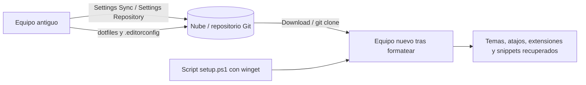
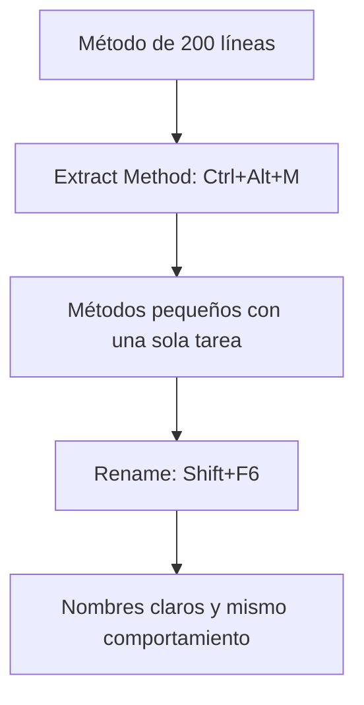
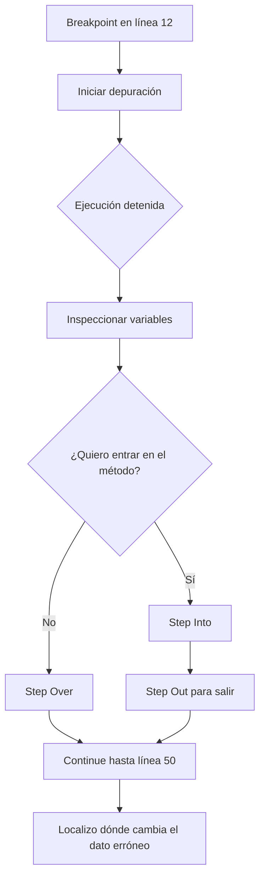
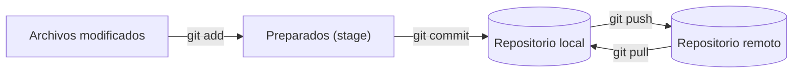
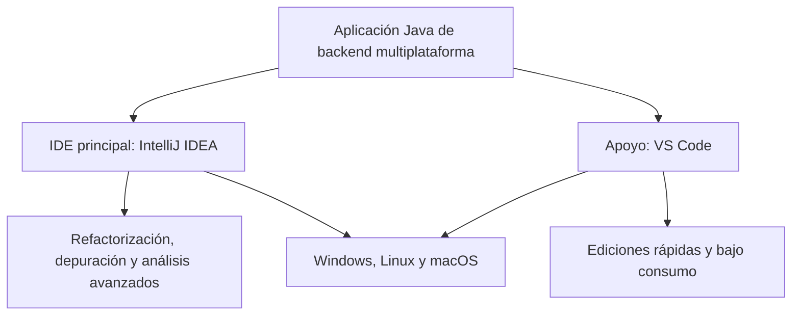

# AC202-Mohamed Amin Ben Assad El Arine
**Mohamed Amin Ben Assad El Arine**  
**Módulo:** Entornos de Desarrollo  
**Curso:** 1.º DAW

## Enunciado

---

## Solución / procedimiento

### 1. Personalización y configuración reproducible

**Problema:** tras formatear el ordenador, la desarrolladora pierde temas, atajos, extensiones y snippets.

**Cómo ayudan las herramientas de configuración reproducible:**

- **Dotfiles:** son archivos de configuración que empiezan por punto (`.editorconfig`, `.settings.json`...). Si se guardan en un repositorio Git, la configuración queda versionada ("configuración como código") y se puede descargar en cualquier equipo con un simple `git clone`.
- **`.editorconfig`:** define el formato del código (sangría, fin de línea, codificación...) en la raíz del proyecto. Lo respetan IntelliJ IDEA y VS Code, así que todo el equipo tiene el mismo estilo aunque use IDE distintos, y se evitan diferencias de formato en las revisiones.
- **Sincronización de ajustes:**
  - **VS Code → Settings Sync:** `Ctrl+Shift+P` → *Settings Sync: Turn On*, se eligen ajustes, atajos, extensiones, snippets y estado de la interfaz, y se inicia sesión con GitHub o Microsoft. En el equipo nuevo se activa y se elige *Download*.
  - **JetBrains → Settings Repository** (o sincronización con la cuenta JetBrains): se configura un repositorio Git y los ajustes se sincronizan al abrir y cerrar el IDE.
  - La sincronización incluye configuración del editor, atajos, plugins, snippets y apariencia; **no** incluye el código del proyecto.
- **Scripts de instalación:** un script con `winget` (por ejemplo `setup.ps1`) instala VS Code, Git, Oh My Posh y la extensión Java automáticamente.



**Opciones de personalización disponibles:**

| Aspecto | IntelliJ IDEA | VS Code |
|---|---|---|
| Acceso a la configuración | `Ctrl+Alt+S` (File > Settings) | `Ctrl+,` o editar `settings.json` |
| Tema | Light, Dark, Darcula, Dracula | Extensiones de temas |
| Fuente | Editor > Font (JetBrains Mono, Fira Code con ligaduras) | `editor.fontFamily`, `editor.fontLigatures` |
| Atajos | Keymap | Atajos de teclado y extensiones Keymap |
| Plugins / extensiones | Settings > Plugins | `Ctrl+Shift+X` |
| Guardado | Automático | `files.autoSave` |

---

### 2. Refactorización

**Qué es:** refactorizar es mejorar la estructura y la facilidad de comprensión del código **sin cambiar su funcionalidad externa**. Pertenece al mantenimiento del código.

**Por qué se debe conservar el comportamiento:** si cambia lo que hace el programa, ya no es refactorizar sino modificar la funcionalidad, con el riesgo de introducir errores. El programa debe comportarse de forma idéntica antes y después; por eso conviene ejecutarlo antes y después y usar la previsualización (*Refactoring Preview*) en cambios grandes.

**Caso:** un método de 200 líneas que realiza varias tareas.

**Dos refactorizaciones de IntelliJ IDEA:**

1. **Extract Method** (`Ctrl+Alt+M`): convierte un bloque de código seleccionado en un método nuevo y lo sustituye por una llamada. Así el método de 200 líneas se divide en métodos pequeños, cada uno con una única tarea, y desaparece el código duplicado.

   ```java
   // Antes
   double area1 = Math.PI * radius1 * radius1;
   double area2 = Math.PI * radius2 * radius2;

   // Después de Extract Method
   double area1 = calcularArea(radius1);
   double area2 = calcularArea(radius2);

   private static double calcularArea(double radius) {
       return Math.PI * radius * radius;
   }
   ```

2. **Rename** (`Shift+F6`): cambia el nombre de una variable, método o clase y actualiza **todas** las referencias a la vez. Sirve para sustituir nombres poco claros (`x`, `tmp`) por nombres descriptivos (`precioTotal`).

Otras refactorizaciones disponibles: *Change Signature* (`Ctrl+F6`, modifica los parámetros de un método), *Extract Variable* (`Ctrl+Alt+V`), *Safe Delete* (`Alt+Delete`).



---

### 3. Depuración con breakpoints

**Problema:** el error se muestra en la línea 50, pero el dato incorrecto se asignó en la línea 12.

**Cómo lo investigaría:**

1. Pondría un **breakpoint** en la línea 12 (clic en el *gutter* en IntelliJ IDEA, o `F9` en VS Code), que es donde se asigna el dato.
2. Iniciaría la depuración (`Shift+F9` en IntelliJ IDEA, `F5` en VS Code). El programa se detiene al llegar a ese punto.
3. En la ventana de **variables locales** examinaría el nombre, tipo y valor de las variables y comprobaría si el valor ya es incorrecto.
4. Avanzaría paso a paso hacia la línea 50 vigilando en qué momento cambia el valor. Si hace falta, puede modificar el valor de una variable en ese momento para probar otros escenarios, o usar un breakpoint condicional para detenerse solo cuando se cumpla una condición.

**Diferencia entre los comandos de ejecución controlada:**

| Comando | IntelliJ IDEA | VS Code | Qué hace |
|---|---|---|---|
| **Step Over** | `F8` | `F10` | Ejecuta la línea actual y pasa a la siguiente, sin entrar en los métodos llamados |
| **Step Into** | `F7` | `F11` | Entra dentro del método llamado en la línea actual |
| **Step Out** | `Shift+F8` | `Shift+F11` | Termina el método actual y vuelve al código que lo llamó |



---

### 4. Control de versiones integrado

**Por qué conviene usarlo:** permite controlar los cambios que sufre el código durante su desarrollo, volver a una versión anterior si algo falla, trabajar en equipo sin pisarse el trabajo y no perder código. Debe usarse desde el primer día, aunque el proyecto sea pequeño.

**Conceptos:**

- **commit:** guarda en el repositorio local un conjunto de cambios con un mensaje descriptivo. Un commit debe ser un cambio lógico.
- **push:** sube los commits locales al repositorio remoto.
- **pull:** descarga los cambios del repositorio remoto y los integra en el local.



**Ventajas y límites de hacerlo desde el IDE frente a la terminal:**

| | Desde el IDE | Desde la terminal |
|---|---|---|
| Ventajas | Interfaz visual: se ven los archivos modificados, se elige qué incluir en cada commit, se comparan versiones y se resuelven conflictos con el editor de fusiones. Atajos como `Ctrl+K` (commit) y `Ctrl+Shift+K` (push) en IntelliJ IDEA, o `Ctrl+Shift+G` en VS Code. | Control total, mismos comandos en cualquier equipo e IDE, útil para operaciones avanzadas. |
| Límites | Cubre las operaciones habituales, pero no todas las opciones avanzadas de Git, y depende de cada IDE. | Hay que recordar los comandos (`git add`, `git commit`, `git push`...) y es menos visual. |

La terminal integrada permite combinar ambas opciones sin salir del IDE.

---

### 5. Elegir un IDE para Java multiplataforma

**Comparativa:**

| Criterio | IntelliJ IDEA | VS Code |
|---|---|---|
| Integración con Java | Excelente, es el IDE de referencia para Java; muy buen análisis de código y refactorización | Buena, gracias a Extension Pack for Java (autocompletado, depuración, pruebas, Maven) |
| Herramientas disponibles | Muchas de serie: refactorización avanzada, depurador, Git, Local History, Maven y Gradle | Hay que instalar extensiones (Extension Pack for Java, Gradle for Java, SonarQube for IDE) |
| Consumo de recursos | Mayor, es un IDE completo y más pesado | Ligero, arranca en segundos |
| Multiplataforma | Windows, Linux y macOS | Windows, Linux y macOS |
| Licencia | Community gratuita; Ultimate de pago (gratis con Student Pack) | Gratuito y open source |

**Recomendación:** recomendaría **IntelliJ IDEA** como IDE principal del equipo para una aplicación Java de backend. Ofrece la mejor integración con Java, refactorización y depuración potentes y funciona igual en Windows, Linux y macOS, lo que ayuda a mantener un entorno homogéneo. La edición Community es gratuita y suficiente. **VS Code** quedaría como apoyo para tareas rápidas y archivos ligeros, ya que consume menos recursos. En ambos se usaría `.editorconfig` para mantener el mismo formato de código en todo el equipo.



---

## Capturas / evidencias

La actividad indica que no es necesario realizar cambios en el código ni en la configuración, por lo que no se solicitan capturas.
