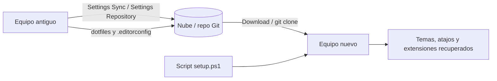
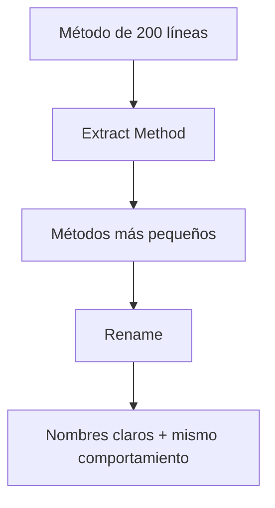
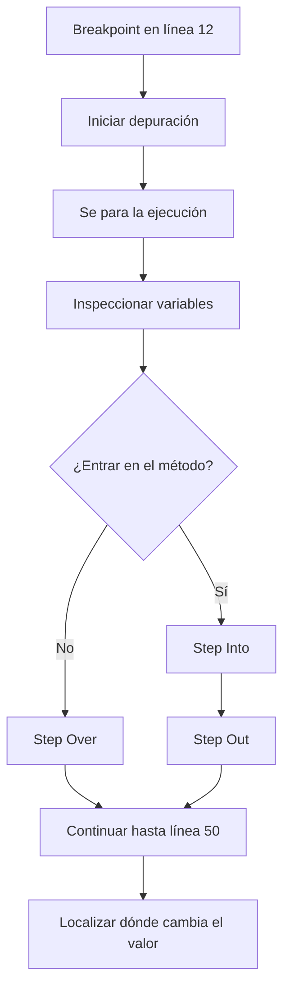
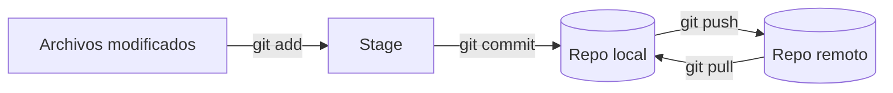
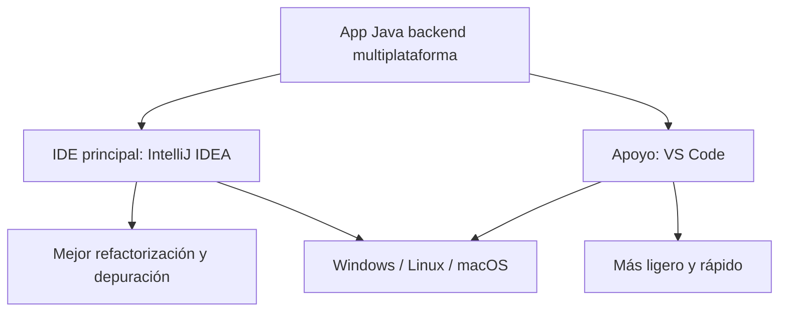

# AC202 – Mohamed Amin Ben Assad El Arine  
**Módulo:** Entornos de Desarrollo  
**Curso:** 1.º DAW

## 1. Personalización y configuración reproducible

Si formateas el ordenador te cargas todos los temas, atajos, extensiones y snippets. Para no perderlos se pueden usar varias cosas:

- **Dotfiles**: son los archivos de configuración que empiezan por punto. Si los subes a un repositorio de Git, luego solo tienes que clonar el repo en el ordenador nuevo y recuperas casi todo.
- **`.editorconfig`**: se pone en la raíz del proyecto y define cómo tiene que ir el código (sangría, finales de línea, etc.). Tanto IntelliJ como VS Code lo respetan, así que todo el mundo escribe igual aunque use IDE distintos.
- **Sincronización de ajustes**:
  - En VS Code está Settings Sync. Se activa desde la paleta de comandos y se inicia sesión con GitHub o Microsoft. Luego en el otro equipo solo hay que darle a descargar.
  - En IntelliJ se puede usar Settings Repository o la cuenta de JetB  rains.
- También se puede hacer un script con `winget` para instalar automáticamente VS Code, Git, etc.



**Personalización rápida:**

| Aspecto              | IntelliJ IDEA              | VS Code                  |
|----------------------|----------------------------|--------------------------|
| Entrar a configuración | `Ctrl+Alt+S`              | `Ctrl+,`                 |
| Temas                | Light, Dark, Darcula…     | Extensiones de temas     |
| Fuente               | Editor > Font             | `editor.fontFamily`      |
| Atajos               | Keymap                    | Atajos de teclado        |
| Extensiones          | Settings > Plugins        | `Ctrl+Shift+X`           |

---

## 2. Refactorización

Refactorizar es mejorar el código (que se entienda mejor, que esté más ordenado) **sin cambiar lo que hace**. Si cambias el comportamiento ya no es refactorizar.

En un método de 200 líneas se pueden usar, por ejemplo:

1. **Extract Method** (`Ctrl+Alt+M`): seleccionas un trozo de código y lo conviertes en un método nuevo. Así divides el método grande en varios más pequeños.
2. **Rename** (`Shift+F6`): cambia el nombre de una variable o método y actualiza todas las referencias de golpe. Útil para quitar nombres feos tipo `x` o `tmp`.

Otras que también se usan bastante: Extract Variable, Change Signature y Safe Delete.



---

## 3. Depuración con breakpoints

Si el error sale en la línea 50 pero el valor malo se asignó en la 12, lo lógico es:

1. Poner un breakpoint en la línea 12.
2. Arrancar en modo debug (`Shift+F9` en IntelliJ o `F5` en VS Code).
3. Mirar las variables locales cuando se para.
4. Ir avanzando con Step Over / Step Into hasta ver en qué momento se estropea el valor.

| Comando     | IntelliJ     | VS Code       | Qué hace                        |
|-------------|--------------|---------------|---------------------------------|
| Step Over   | `F8`         | `F10`         | Ejecuta la línea y sigue        |
| Step Into   | `F7`         | `F11`         | Entra dentro del método         |
| Step Out    | `Shift+F8`   | `Shift+F11`   | Sale del método actual          |



---

## 4. Control de versiones integrado

Conviene usarlo desde el principio porque permite guardar el historial de cambios, volver atrás si algo se rompe y trabajar en equipo sin pisarse el código.

- **commit**: guarda los cambios en el repositorio local con un mensaje.
- **push**: sube esos commits al remoto.
- **pull**: trae los cambios del remoto.



**Desde el IDE vs terminal:**

|                  | Desde el IDE                                      | Desde la terminal                          |
|------------------|---------------------------------------------------|--------------------------------------------|
| Ventajas         | Más visual, se ven los cambios, más fácil resolver conflictos | Control total, mismos comandos en cualquier sitio |
| Límites          | No tiene todas las opciones avanzadas             | Hay que saberse los comandos               |

---

## 5. Elegir un IDE para Java multiplataforma

| Criterio               | IntelliJ IDEA                          | VS Code                              |
|------------------------|----------------------------------------|--------------------------------------|
| Integración con Java   | Muy buena (es el de referencia)        | Buena con el Extension Pack for Java |
| Herramientas           | Muchas de serie                        | Hay que instalar extensiones         |
| Consumo                | Más pesado                             | Muy ligero                           |
| Multiplataforma        | Windows, Linux y macOS                 | Windows, Linux y macOS               |
| Precio                 | Community gratis                       | Totalmente gratis                    |

**Recomendación:**  
Para una aplicación Java de backend me quedaría con **IntelliJ IDEA** como IDE principal porque tiene mejor refactorización y depuración. VS Code lo usaría de apoyo para cosas rápidas porque pesa mucho menos. En ambos pondría un `.editorconfig` para que el formato del código sea igual.



---

## Capturas / evidencias

La actividad dice que no hace falta hacer cambios ni capturas, así que no las incluyo.
```