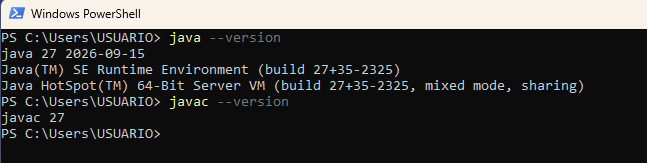
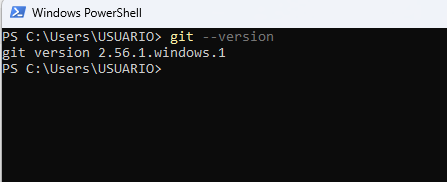
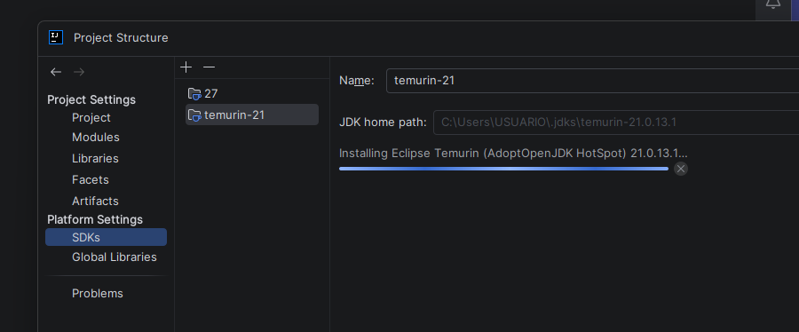
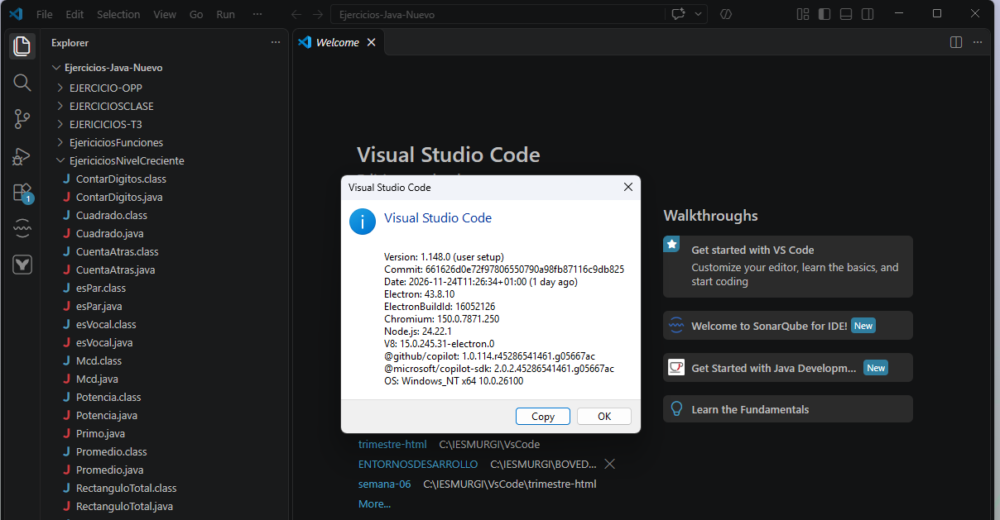
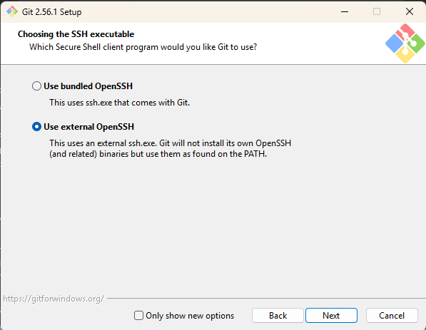
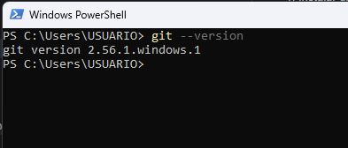
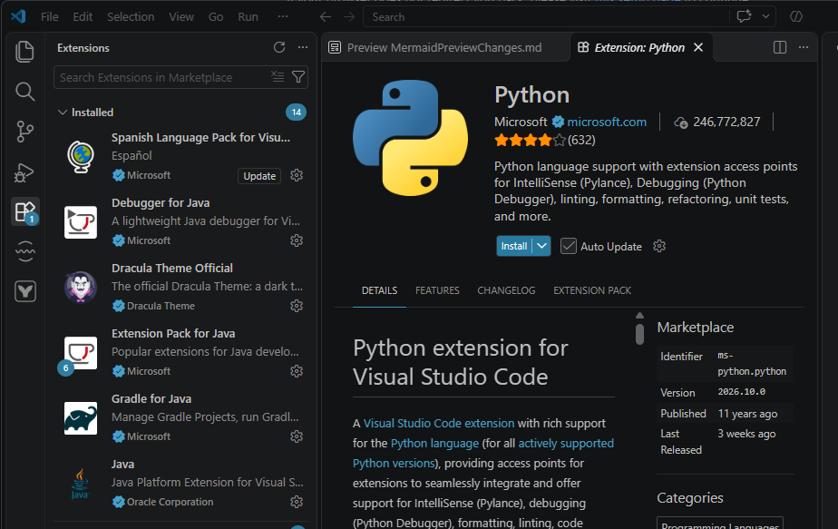
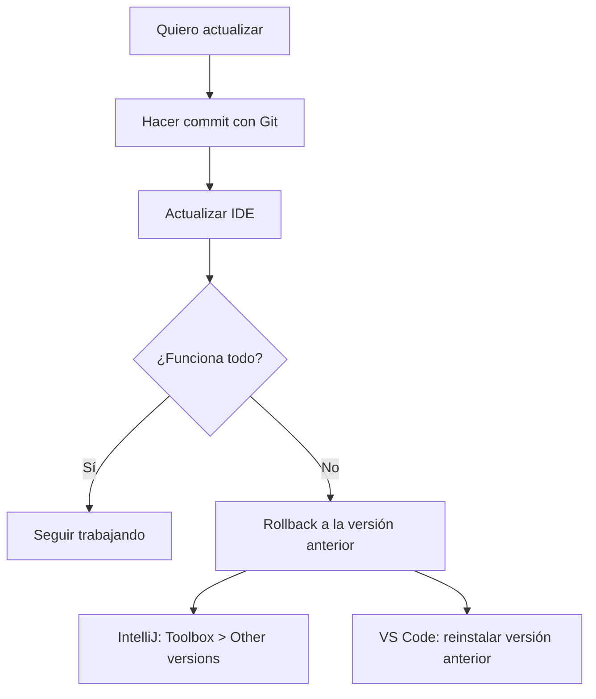

# AC203-Mohamed Amin Ben Assad El Arine
**Mohamed Amin Ben Assad El Arine**  
**Módulo:** Entornos de Desarrollo  
**Curso:** 1.º DAW


## Enunciado

Preparar el equipo para programar en Java con IntelliJ IDEA y VS Code, reutilizando el JDK ya instalado en Programación y seleccionando JDK 21 LTS en el proyecto. La actividad tiene tres partes: instalación de herramientas, gestión de plugins/extensiones y configuración de actualizaciones (6 puntos).

---

## Solución / procedimiento

## Parte I: instalación de herramientas

### 1. Verificar el JDK

En una terminal (PowerShell) se ejecutan:

```powershell
java --version
javac --version
```

Para desarrollar en Java se necesita un JDK (no un JRE), porque incluye `javac` para compilar. IntelliJ IDEA lleva su propio JetBrains Runtime, pero solo sirve para ejecutar el IDE, no para compilar el proyecto. Se usa una versión LTS (21) por ser estable.

>
> 
>

### 2. Instalar IntelliJ IDEA

Toolbox es la forma recomendada de instalar porque permite gestionar varias versiones, actualizar y volver a una versión anterior (rollback) desde un único sitio.


>
> 
> 

### 3. Instalar VS Code

Versión obtenida: `1.140.0(User setup)`

>
### 4. Instalar Git


```powershell
git --version
```
>
>

### 5. Instalar y configurar Oh My Posh

```powershell
winget install JanDeDobbeleer.OhMyPosh
```


```powershell
>oh-my-posh init pwsh --config "$env:POSH_THEMES_PATH\agnoster.omp.json" | Invoke-Expression
```

>
> 
> 
>
---

## Parte II: plugins y extensiones

### 1. VS Code: Extension Pack for Java


>

### 2. IntelliJ IDEA: Key Promoter X

Desactivar (*Disable*) un plugin lo deja instalado pero inactivo, y desinstalarlo lo elimina. Desactivar es más seguro si solo se quiere descartar un problema.

>
> 
> 
### 3. VS Code: instalar y quitar una extensión

>
> 

---

## Parte III: actualizaciones

### 1. IntelliJ IDEA

El canal Stable es la versión probada, recomendada para trabajo real. EAP y Nightly son versiones preliminares o inestables.

>

### 2. VS Code

> 

### Precauciones antes de actualizar

**Por qué confirmar los cambios con Git antes de actualizar:** algunas actualizaciones pueden cambiar la configuración del proyecto o requerir la migración de plugins. Si se hace un commit antes, el trabajo queda guardado y se puede recuperar el estado anterior del código si algo falla.

**Qué haría si una actualización causa problemas:**

- **IntelliJ IDEA:** abrir JetBrains Toolbox, localizar IntelliJ IDEA, abrir el menú de versiones, elegir **Other versions**, seleccionar la versión anterior y pulsar **Install**. Después comprobar que los proyectos funcionan.
>

- **VS Code:** descargar la versión anterior desde `https://code.visualstudio.com/updates/v1XX` (XX = número de versión) e instalarla encima de la actual.
>
>
- Si el problema viene de un plugin, desactivarlo antes de desinstalarlo, ya que las actualizaciones de plugins son independientes de las del IDE.



---

## Capturas / evidencias

Capturas obligatorias, todas dentro de `assets/`:

| Evidencia | Archivo |
|---|---|
| Versiones de Java y Git | `java-version.png`, `git-version.png` |
| IntelliJ IDEA con el JDK seleccionado | `idea-jdk.png` |
| VS Code instalado | `vscode-about.png` |
| Oh My Posh funcionando | `oh-my-posh.png` |
| Extensión Java instalada | `vscode-java-pack.png` |
| Plugins/extensiones antes y después de quitarlos | `idea-plugins-antes.png`, `idea-plugins-despues.png`, `vscode-ext-antes.png`, `vscode-ext-despues.png` |
| Opciones de actualización | `idea-updates.png`, `vscode-update-mode.png` |


