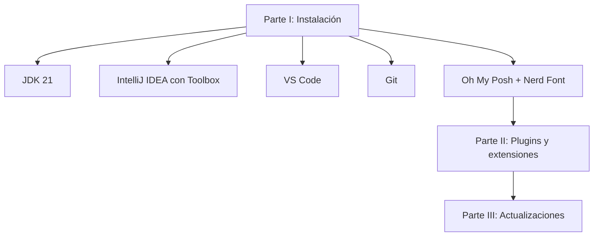
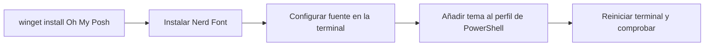
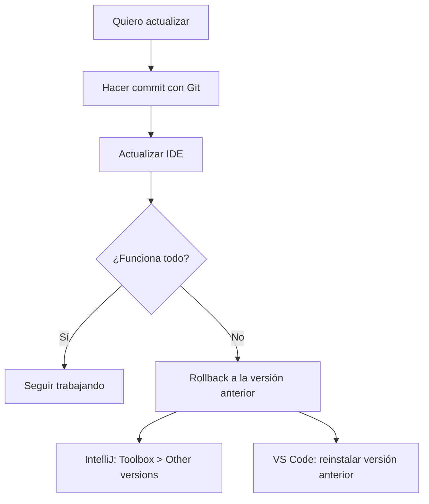

# AC203-Mohamed Amin Ben Assad El Arine
**Mohamed Amin Ben Assad El Arine**  
**Módulo:** Entornos de Desarrollo  
**Curso:** 1.º DAW


## Enunciado

Preparar el equipo para programar en Java con IntelliJ IDEA y VS Code, reutilizando el JDK ya instalado en Programación y seleccionando JDK 21 LTS en el proyecto. La actividad tiene tres partes: instalación de herramientas, gestión de plugins/extensiones y configuración de actualizaciones (6 puntos).

> Las capturas marcadas como **[CAPTURAR]** debes hacerlas tú en tu equipo y guardarlas en la carpeta `assets/` con los nombres indicados. Los campos entre corchetes también los rellenas tú con lo que veas en pantalla.



---

## Solución / procedimiento

## Parte I: instalación de herramientas

### 1. Verificar el JDK

En una terminal (PowerShell) se ejecutan:

```powershell
java --version
javac --version
```

Resultado obtenido: `[pega aquí la salida]`

En IntelliJ IDEA: **File > Project Structure > SDKs** y se comprueba que el proyecto usa el JDK 21 instalado. Si no aparece, se selecciona de la lista o se usa **Add SDK > Download JDK** para obtener JDK 21 de Amazon Corretto o Eclipse Temurin.

Justificación: para desarrollar en Java se necesita un JDK (no un JRE), porque incluye `javac` para compilar. IntelliJ IDEA lleva su propio JetBrains Runtime, pero solo sirve para ejecutar el IDE, no para compilar el proyecto. Se usa una versión LTS (21) por ser estable.

**[CAPTURAR]** `assets/java-version.png` (salida de `java --version` y `javac --version`)
**[CAPTURAR]** `assets/idea-jdk.png` (Project Structure con el JDK 21 seleccionado)

### 2. Instalar IntelliJ IDEA

1. Descargar e instalar **JetBrains Toolbox** desde la página oficial de JetBrains.
2. Desde Toolbox, instalar **IntelliJ IDEA**.
3. Edición y licencia: **[Community Edition, gratuita / Ultimate con Student Pack, según lo que uses]**.

Justificación: Toolbox es la forma recomendada de instalar porque permite gestionar varias versiones, actualizar y volver a una versión anterior (rollback) desde un único sitio.

**[CAPTURAR]** `assets/toolbox-idea.png` (Toolbox con IntelliJ IDEA instalado y su edición)

### 3. Instalar VS Code

1. Descargar el instalador desde `https://code.visualstudio.com` y ejecutarlo.
2. Comprobar la versión desde **Help > About**.

Versión obtenida: `[pon aquí la versión]`

**[CAPTURAR]** `assets/vscode-about.png` (Help > About)

### 4. Instalar Git

Opción con instalador oficial (dejando activada la opción de añadirlo al `PATH`) o con winget:

```powershell
winget install --id Git.Git --exact
git --version
```

Resultado obtenido: `[pega aquí la salida]`

**[CAPTURAR]** `assets/git-version.png` (salida de `git --version`)

### 5. Instalar y configurar Oh My Posh

```powershell
winget install JanDeDobbeleer.OhMyPosh
```

1. Instalar una **Nerd Font** (por ejemplo, FiraCode Nerd Font) desde nerdfonts.com. Se instala primero la fuente y luego se configura, o los iconos se verán como cuadros.
2. Configurar la fuente en Windows Terminal: **Configuración > Perfil > Apariencia > Fuente** y seleccionar la Nerd Font.
3. Añadir un tema (por ejemplo, Agnoster) al perfil de PowerShell. Se abre con `notepad $PROFILE` y se añade una línea como:

```powershell
oh-my-posh init pwsh --config "$env:POSH_THEMES_PATH\agnoster.omp.json" | Invoke-Expression
```

4. Reiniciar la terminal y comprobar que se ven los iconos y la rama de Git.

**[CAPTURAR]** `assets/oh-my-posh.png` (terminal con Oh My Posh e iconos visibles)



---

## Parte II: plugins y extensiones

| Extensión | Función |
|---|---|
| Extension Pack for Java | Autocompletado, ejecución, depuración y pruebas de Java |
| GitLens | Visualizar historial y actividad de Git |
| Prettier | Formatear HTML, CSS, JSON y Markdown |
| Python (Microsoft) | Soporte para Python, si se necesita en otro módulo |

### 1. VS Code: Extension Pack for Java

1. Abrir Extensiones con `Ctrl+Shift+X`.
2. Buscar **Extension Pack for Java** y pulsar **Install**.
3. Comprobar que aparece en **Installed**.

Alternativa por terminal: `code --install-extension vscjava.vscode-java-pack`

**[CAPTURAR]** `assets/vscode-java-pack.png`

### 2. IntelliJ IDEA: Key Promoter X

1. Abrir **File > Settings > Plugins** (`Ctrl+Alt+S`).
2. Buscar **Key Promoter X** en Marketplace, pulsar **Install** y reiniciar el IDE.
3. Comprobar que funciona ejecutando una acción desde un menú: el plugin muestra qué atajo se podía haber usado.
4. En **Settings > Plugins > Installed**, seleccionar el plugin, pulsar **Uninstall** y reiniciar.

Nota: desactivar (*Disable*) un plugin lo deja instalado pero inactivo, y desinstalarlo lo elimina. Desactivar es más seguro si solo se quiere descartar un problema.

**[CAPTURAR]** `assets/idea-plugins-antes.png` (lista de plugins antes)
**[CAPTURAR]** `assets/idea-plugins-despues.png` (lista de plugins después de desinstalar)

### 3. VS Code: instalar y quitar una extensión

1. Buscar **Python (Microsoft)** en Extensiones, instalarla y comprobar que aparece en **Installed**. (Si no trabajas con Python, haz la demostración con **GitLens**.)
2. Usar su menú para **Disable** y después **Uninstall**.
3. Verificar que ya no aparece instalada.

**[CAPTURAR]** `assets/vscode-ext-antes.png`
**[CAPTURAR]** `assets/vscode-ext-despues.png`

---

## Parte III: actualizaciones

### 1. IntelliJ IDEA

1. **Help > Check for Updates** para comprobar si hay una versión nueva.
2. **Settings > Appearance & Behavior > System Settings > Updates**.
3. Seleccionar el canal **Stable** y activar **Check for updates automatically**.

Justificación: el canal Stable es la versión probada, recomendada para trabajo real. EAP y Nightly son versiones preliminares o inestables.

**[CAPTURAR]** `assets/idea-updates.png`

### 2. VS Code

1. Consultar la versión desde **Help > About** y comprobar el indicador de actualización.
2. Abrir **Settings** (`Ctrl+,`) y buscar `update.mode`.
3. Mantener el modo predeterminado (`default`) para recibir actualizaciones.

**[CAPTURAR]** `assets/vscode-update-mode.png`

### Precauciones antes de actualizar

**Por qué confirmar los cambios con Git antes de actualizar:** algunas actualizaciones pueden cambiar la configuración del proyecto o requerir la migración de plugins. Si se hace un commit antes, el trabajo queda guardado y se puede recuperar el estado anterior del código si algo falla.

**Qué haría si una actualización causa problemas:**

- **IntelliJ IDEA:** abrir JetBrains Toolbox, localizar IntelliJ IDEA, abrir el menú de versiones, elegir **Other versions**, seleccionar la versión anterior y pulsar **Install**. Después comprobar que los proyectos funcionan.
- **VS Code:** descargar la versión anterior desde `https://code.visualstudio.com/updates/v1XX` (XX = número de versión) e instalarla encima de la actual.
- Si el problema viene de un plugin, desactivarlo antes de desinstalarlo, ya que las actualizaciones de plugins son independientes de las del IDE.



---

## Capturas / evidencias

Capturas obligatorias, todas dentro de `assets/`:

| Evidencia | Archivo |
|---|---|
| Versiones de Java y Git | `java-version.png`, `git-version.png` |
| IntelliJ IDEA con el JDK seleccionado | `idea-jdk.png` |
| VS Code instalado | `vscode-about.png` |
| Oh My Posh funcionando | `oh-my-posh.png` |
| Extensión Java instalada | `vscode-java-pack.png` |
| Plugins/extensiones antes y después de quitarlos | `idea-plugins-antes.png`, `idea-plugins-despues.png`, `vscode-ext-antes.png`, `vscode-ext-despues.png` |
| Opciones de actualización | `idea-updates.png`, `vscode-update-mode.png` |

Para enlazarlas en Markdown se usa una ruta relativa, por ejemplo:

```markdown

```

## Entrega

1. Nombrar el archivo con el código y tu nombre, por ejemplo `AC203TuNombre.md`.
2. Crear un ZIP con el mismo nombre base (`AC203TuNombre.zip`) que contenga el `.md` y la carpeta `assets/`, sin carpeta envolvente extra.
3. Descomprimirlo en otra ubicación y comprobar que las imágenes se ven.
4. No entregar PDF.
