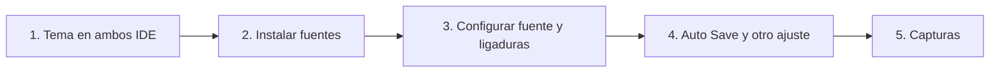
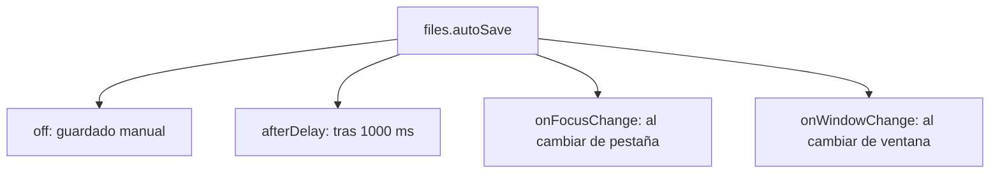

# AC204-Mohamed Amin Ben Assad El Arine
**Mohamed Amin Ben Assad El Arine**  
**Módulo:** Entornos de Desarrollo  
**Curso:** 1.º DAW


Nombre: [Tu nombre]
Sistema operativo: Windows

## Enunciado

Configurar IntelliJ IDEA y VS Code para que el entorno de trabajo sea cómodo, coherente y adecuado para programar en Java. Se pide: elegir un tema en ambos IDE, instalar y configurar fuentes con ligaduras, configurar el guardado automático y otro ajuste, e incluir capturas (3 puntos).

> Las capturas marcadas como **[CAPTURAR]** debes hacerlas tú y guardarlas en `assets/` con los nombres indicados.



---

## Solución / procedimiento

### 1. Elegir un tema (0,5 p)

Tema elegido: **Dracula** (disponible en ambos IDE; puedes usar Material Theme si prefieres).

**IntelliJ IDEA**

1. Abrir **File > Settings > Plugins** (`Ctrl+Alt+S`).
2. Buscar el tema en Marketplace y pulsar **Install**; reiniciar si lo pide.
3. Seleccionarlo en **Settings > Appearance & Behavior > Appearance > Theme**.

**VS Code**

1. Abrir Extensiones con `Ctrl+Shift+X`.
2. Buscar el tema y pulsar **Install**.
3. Seleccionarlo en **File > Preferences > Theme > Color Theme** (o con `Ctrl+K Ctrl+T`).

Justificación: un tema oscuro reduce la fatiga visual en sesiones largas de programación, y usar el mismo tema en ambos IDE da un aspecto coherente al cambiar de uno a otro.

**[CAPTURAR]** `assets/tema-idea.png`
**[CAPTURAR]** `assets/tema-vscode.png`

---

### 2. Instalar y configurar fuentes (1 p)

Fuentes a instalar:

- **Fira Code**, desde su repositorio oficial.
- **FiraCode Nerd Font**, desde nerdfonts.com.

**Instalación en Windows:** abrir los archivos de fuente descargados (`.ttf`) y pulsar **Instalar**.

**Instalación en Ubuntu (por si se necesita):** copiar los `.ttf` a `~/.local/share/fonts` y actualizar la caché con `fc-cache -f`.

Diferencia entre ambas: Fira Code aporta las ligaduras para el editor; FiraCode Nerd Font añade además miles de iconos extra que necesita Oh My Posh en la terminal. Se instala siempre primero la fuente y luego se configura.

**IntelliJ IDEA**

1. Abrir **Settings > Editor > Font**.
2. Seleccionar **Fira Code**.
3. Activar **Enable ligatures**.

**VS Code**

1. Abrir `settings.json` con `Ctrl+Shift+P` > **Preferences: Open User Settings (JSON)**.
2. Añadir:

```json
{
  "editor.fontFamily": "Fira Code",
  "editor.fontSize": 14,
  "editor.lineHeight": 1.2,
  "editor.fontLigatures": true,
  "terminal.integrated.fontFamily": "FiraCode Nerd Font",
  "files.autoSave": "afterDelay",
  "files.autoSaveDelay": 1000
}
```

**Terminal con Oh My Posh:** en Windows Terminal, ir a **Configuración > Perfil > Apariencia > Fuente** y seleccionar **FiraCode Nerd Font**. Los iconos deben verse correctamente, sin cuadros ni caracteres raros.

Qué son las ligaduras: combinaciones de caracteres que se muestran como un solo símbolo, por ejemplo `!=` como ≠ o `=>` como ⇒, lo que hace el código más legible.

**[CAPTURAR]** `assets/fuente-idea.png` (ajustes de fuente con ligaduras activadas)
**[CAPTURAR]** `assets/fuente-vscode.png` (código con ligaduras visibles y `settings.json`)
**[CAPTURAR]** `assets/terminal-iconos.png` (terminal con iconos visibles)

---

### 3. Guardado automático y otro ajuste (0,5 p)

**Guardado automático en VS Code**

Se configura desde **Settings > Auto Save** o con las propiedades de `settings.json` ya incluidas:

| Propiedad | Valor | Efecto |
|---|---|---|
| `files.autoSave` | `afterDelay` | Guarda automáticamente tras un retardo |
| `files.autoSaveDelay` | `1000` | Retardo de 1000 ms |

Otros valores posibles de `files.autoSave`: `off` (manual, por defecto), `onFocusChange` (al cambiar de pestaña) y `onWindowChange` (al cambiar de ventana). Para trabajar con más agilidad conviene `afterDelay` con 1000 ms.

**Otro ajuste en IntelliJ IDEA**

Ajuste elegido: **[elige uno, por ejemplo: cambiar el atajo de una acción en Settings > Keymap / activar Build project automatically en Settings > Build, Execution, Deployment > Compiler / reformatear al guardar]**.

Justificación: **[explica en una frase por qué te resulta útil]**.

**[CAPTURAR]** `assets/autosave-vscode.png`
**[CAPTURAR]** `assets/ajuste-idea.png`



---

### 4. Capturas completas (1 p)

| Evidencia | Archivo |
|---|---|
| Tema en IntelliJ IDEA | `tema-idea.png` |
| Tema en VS Code | `tema-vscode.png` |
| Fuente y ligaduras en IntelliJ IDEA | `fuente-idea.png` |
| Fuente y ligaduras en VS Code | `fuente-vscode.png` |
| Ajuste de guardado automático | `autosave-vscode.png` |
| Otro ajuste en IntelliJ IDEA | `ajuste-idea.png` |
| Terminal con los iconos visibles | `terminal-iconos.png` |

Para enlazarlas en Markdown con ruta relativa:

```markdown

```

---

## Entrega

1. Nombrar el archivo como `AC204TuNombre.md`.
2. Crear `AC204TuNombre.zip` con el `.md` y la carpeta `assets/`, sin carpeta envolvente extra.
3. Descomprimirlo en otra ubicación y comprobar que las imágenes se ven.
4. No entregar PDF.

## Reparto de puntos (3 p)

| Apartado | Puntos |
|---|---|
| Tema en ambos IDE | 0,5 |
| Instalación y configuración de la fuente | 1 |
| Guardado automático y otro ajuste | 0,5 |
| Capturas completas | 1 |
