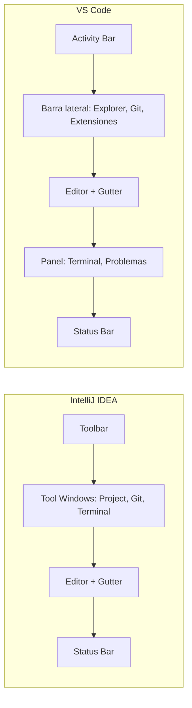
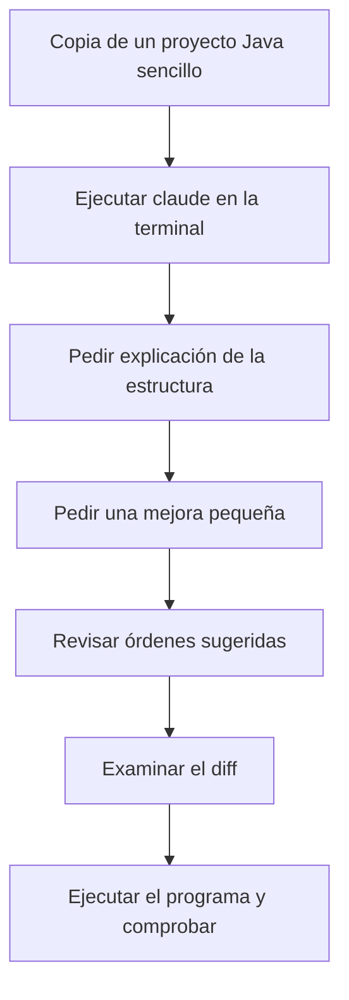

# AC206-Mohamed Amin Ben Assad El Arine
**Mohamed Amin Ben Assad El Arine**  
**Módulo:** Entornos de Desarrollo  
**Curso:** 1.º DAW


## Enunciado

IntelliJ IDEA y VS Code organizan el trabajo de forma diferente, aunque comparten varias funciones. Se comparan los dos entornos, se investigan otros IDE y se prueba una herramienta de programación asistida por IA (3 puntos).

> Las capturas marcadas como **[CAPTURAR]** debes hacerlas tú y guardarlas en `assets/` con los nombres indicados.

---

## Solución / procedimiento

## Parte I: interfaz y navegación (1 p)

| Funcionalidad | IntelliJ IDEA | VS Code | Captura |
|---|---|---|---|
| Gestor de proyecto | Ventana **Project** (Tool Window, `Alt+1`), normalmente a la izquierda. Muestra paquetes, clases y `pom.xml`. | **Explorer** en la Activity Bar (`Ctrl+Shift+E`). Muestra carpetas y archivos del workspace. | **[CAPTURAR]** `assets/gestor-proyecto.png` |
| Terminal integrada | `Alt+F12` (Terminal tool window) | `Ctrl+` ` (Panel inferior) | **[CAPTURAR]** `assets/terminal.png` |
| Barra de herramientas / Activity Bar | **Toolbar** superior con los widgets Project, VCS (rama y acciones de Git) y Run. | **Activity Bar**: barra vertical izquierda para cambiar entre Explorador, Búsqueda, Git, Depuración y Extensiones. | **[CAPTURAR]** `assets/barra-herramientas.png` |
| Panel de configuración | **Settings**, `Ctrl+Alt+S` (File > Settings). Árbol de opciones a la izquierda. | **Settings**, `Ctrl+,`. Cuadro de búsqueda para filtrar ajustes; también `settings.json`. | **[CAPTURAR]** `assets/configuracion.png` |
| Paleta / buscador de comandos | `Ctrl+Shift+A` (buscar cualquier acción) | `Ctrl+Shift+P` (Command Palette, con búsqueda difusa) | **[CAPTURAR]** `assets/paleta.png` |
| Barra de estado | **Status Bar** inferior: mensajes, línea:columna, LF/CRLF, codificación UTF-8, sangría y rama de Git. | **Status Bar** inferior: línea:columna, codificación, saltos de línea y rama de Git. | **[CAPTURAR]** `assets/barra-estado.png` |
| Gutter | Números de línea, breakpoints, iconos de acción (ejecutar, depurar, corregir), marcadores, plegado y líneas modificadas bajo Git. | Números de línea, breakpoints, indicadores de cambios de Git y plegado de código. No tiene los iconos de acción rápida de IntelliJ. | **[CAPTURAR]** `assets/gutter.png` |

**Diferencia principal de organización:** IntelliJ IDEA organiza las herramientas en *Tool Windows* acopladas a los lados y al fondo, y es un IDE completo. VS Code organiza todo en torno a una *Activity Bar* y un *workspace*, y es un editor ligero que se amplía con extensiones.



> Puedes agrupar varias zonas en una captura si se distinguen con claridad.

---

## Parte II: investigación breve de otros IDE (0,5 p)

| IDE | Lenguaje principal | Disponibilidad / compatibilidad | Característica destacada |
|---|---|---|---|
| Eclipse | Java (con plugins admite otros lenguajes) | Gratuito y open source; Windows, Linux y macOS | Arquitectura muy modular basada en plugins (Eclipse Marketplace). Se usa en banca y aeroespacial, por ejemplo en BBVA y la ESA. |
| NetBeans | Java | Gratuito y open source (proyecto Apache); Windows, Linux y macOS | Soporte integrado de Maven y Gradle y un diseñador visual de interfaces gráficas para Java. |
| Xcode | Swift / Objective-C | Solo macOS; gratuito | Entorno oficial para desarrollar aplicaciones de Apple (iOS, macOS, etc.). |

> Revisa estos datos en las páginas oficiales de cada IDE antes de entregar y ajusta lo que quieras.

---

## Parte III: prueba de Claude Code (1 p)

**Antes de empezar:** Claude Code es un agente de programación con IA que trabaja desde la terminal; no es un IDE de escritorio tradicional. Necesitas el acceso indicado por el profesor. Si no lo tienes, consúltalo con él.

**Procedimiento:**

1. Hacer una **copia** de un proyecto Java sencillo (sin datos personales, contraseñas ni tokens).
2. Abrir la terminal en la carpeta de la copia y ejecutar `claude`.
3. Pedirle que explique la estructura del proyecto.
4. Pedirle que proponga una mejora pequeña.
5. Revisar las órdenes que sugiere **antes** de autorizarlas.
6. Examinar el diff de los cambios.
7. Ejecutar el programa para comprobar el resultado.



**Prueba razonada (rellénala con lo que ocurra en tu sesión):**

- Proyecto utilizado: `[nombre]`
- Qué explicó sobre la estructura: `[resumen en 2-3 líneas]`
- Mejora propuesta: `[cuál fue]`
- Cambios del diff: `[qué archivos y líneas cambiaron]`
- Resultado al ejecutar: `[¿el programa funciona igual o mejor?]`
- Valoración: `[qué te pareció útil, qué revisarías siempre antes de aceptar un cambio y en qué se diferencia de un IDE como IntelliJ IDEA o VS Code]`

**[CAPTURAR]** `assets/claude-sesion.png` (sesión) y `assets/claude-diff.png` (diff), ocultando información privada.

---

## Parte IV: resumen de atajos (Windows/Linux) (0,5 p)

| Acción | IntelliJ IDEA | VS Code |
|---|---|---|
| Buscar acciones/comandos | `Ctrl+Shift+A` | `Ctrl+Shift+P` |
| Buscar archivo | `Ctrl+Shift+N` | `Ctrl+P` |
| Abrir terminal | `Alt+F12` | `Ctrl+` ` |
| Guardar | `Ctrl+S` | `Ctrl+S` |
| Abrir configuración | `Ctrl+Alt+S` | `Ctrl+,` |
| Ejecutar | `Shift+F10` | `Ctrl+F5` |
| Depurar | `Shift+F9` | `F5` |
| Renombrar símbolo | `Shift+F6` | `F2` |

Verifica cada atajo en tus IDE instalados y adjunta capturas.

**[CAPTURAR]** `assets/atajos-idea.png`
**[CAPTURAR]** `assets/atajos-vscode.png`

---

## Capturas / evidencias

| Evidencia | Archivo |
|---|---|
| Zonas de la interfaz (tabla de la Parte I) | `gestor-proyecto.png`, `terminal.png`, `barra-herramientas.png`, `configuracion.png`, `paleta.png`, `barra-estado.png`, `gutter.png` |
| Sesión y diff de Claude Code | `claude-sesion.png`, `claude-diff.png` |
| Verificación de atajos | `atajos-idea.png`, `atajos-vscode.png` |

Para enlazarlas en Markdown con ruta relativa:

```markdown

```

## Entrega

1. Nombrar el archivo como `AC206TuNombre.md`.
2. Crear `AC206TuNombre.zip` con el `.md` y la carpeta `assets/`, sin carpeta envolvente extra.
3. Descomprimirlo en otra ubicación y comprobar que las imágenes se ven.
4. No entregar PDF.

## Reparto de puntos (3 p)

| Apartado | Puntos |
|---|---|
| Tabla de interfaz | 1 |
| Investigación de otros IDE | 0,5 |
| Prueba razonada de Claude Code | 1 |
| Resumen de atajos con capturas | 0,5 |
