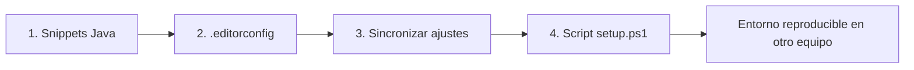
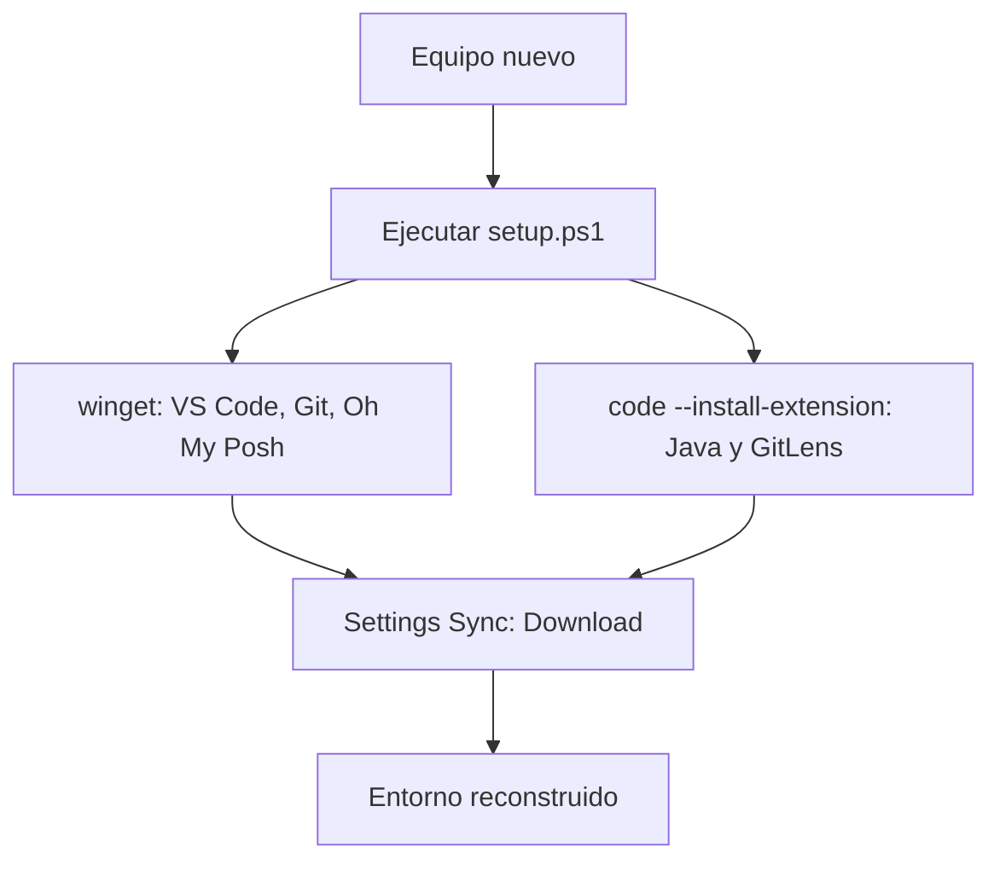

# AP205-Mohamed Amin Ben Assad El Arine
**Mohamed Amin Ben Assad El Arine**  
**Módulo:** Entornos de Desarrollo  
**Curso:** 1.º DAW


Nombre: [Tu nombre]
Sistema operativo: Windows

## Enunciado

Crear configuraciones reutilizables para los proyectos y preparar un método para reconstruir parte del entorno si se cambia de equipo. Se pide: crear snippets Java en VS Code, crear un `.editorconfig`, sincronizar ajustes y automatizar la configuración con un script (3 puntos).

> Las capturas marcadas como **[CAPTURAR]** debes hacerlas tú y guardarlas en `assets/` con los nombres indicados. Los archivos `java.json`, `.editorconfig` y `setup.ps1` van también dentro del ZIP.



---

## Solución / procedimiento

### 1. Crear snippets Java en VS Code (1 p)

1. Abrir la paleta con `Ctrl+Shift+P`.
2. Elegir **Configure User Snippets > Java**.
3. En el archivo `java.json`, escribir:

```json
{
  "Salida por consola": {
    "prefix": "sout",
    "body": ["System.out.println(\"$1\");"],
    "description": "Imprime un mensaje en consola"
  },
  "Bucle for": {
    "prefix": "fori",
    "body": [
      "for (int ${1:i} = 0; ${1:i} < ${2:length}; ${1:i}++) {",
      "\t$0",
      "}"
    ],
    "description": "Bucle for con índice"
  },
  "Método main": {
    "prefix": "main",
    "body": [
      "public static void main(String[] args) {",
      "\t$0",
      "}"
    ],
    "description": "Punto de entrada de la aplicación"
  }
}
```

**Cómo funcionan:** `prefix` es lo que se escribe para activar el snippet, `body` es el código que se inserta, `$1`, `$2` son las posiciones del cursor al pulsar Tab, `${1:i}` es un campo con valor por defecto y `$0` es la posición final del cursor.

**Prueba:** en un archivo `.java`, escribir `sout`, `fori` y `main` y pulsar Tab para expandir cada uno.

Resultado de la prueba: `[describe qué se insertó con cada prefijo]`

**[CAPTURAR]** `assets/java-json.png` (el archivo `java.json`)
**[CAPTURAR]** `assets/snippet-expandido.png` (al menos un snippet expandido en un archivo Java)

---

### 2. Crear `.editorconfig` (0,5 p)

Se guarda en la raíz de un proyecto Java:

```ini
root = true

[*]
charset = utf-8
end_of_line = lf
indent_style = space
indent_size = 4
insert_final_newline = true
```

**Qué hace cada regla:**

| Regla | Efecto |
|---|---|
| `root = true` | Indica que es el archivo raíz, no se buscan más hacia arriba |
| `charset = utf-8` | Codificación de los archivos |
| `end_of_line = lf` | Saltos de línea tipo Unix |
| `indent_style = space` | Sangría con espacios, no tabuladores |
| `indent_size = 4` | Cuatro espacios por nivel |
| `insert_final_newline = true` | Añade una línea en blanco al final del archivo |

**Comprobación:** abrir el proyecto en IntelliJ IDEA y en VS Code, pulsar Tab en un archivo Java y comprobar que se insertan 4 espacios. En ambos IDE se respetan las reglas del archivo (IntelliJ IDEA lo soporta de serie y VS Code puede necesitar la extensión **EditorConfig for VS Code** si no lo aplica).

Resultado de la comprobación: `[describe lo que observaste en cada IDE]`

**[CAPTURAR]** `assets/editorconfig.png` (el archivo en la raíz del proyecto)

---

### 3. Sincronizar ajustes (0,5 p)

**VS Code: Settings Sync**

1. Abrir la paleta (`Ctrl+Shift+P`) y elegir **Settings Sync: Turn On**.
2. Seleccionar qué sincronizar: ajustes, atajos, extensiones, snippets y apariencia.
3. Iniciar sesión con GitHub o Microsoft.
4. En otro equipo: activar Settings Sync y elegir **Download**.

**IntelliJ IDEA**

1. Abrir **Settings > Settings Sync** e iniciar sesión con la cuenta JetBrains.
2. Seleccionar qué ajustes sincronizar.
3. Si esa opción no está disponible en la versión instalada, usar el plugin **Settings Repository** (**File > Settings Repository**) con un repositorio Git.

La sincronización incluye configuración del editor, atajos, extensiones o plugins, snippets y apariencia; no incluye los archivos del proyecto ni el código.

**[CAPTURAR]** `assets/sync-vscode.png`
**[CAPTURAR]** `assets/sync-idea.png`

> Oculta cualquier dato personal (nombre de usuario, correo) en las capturas.

---

### 4. Automatizar la configuración con un script (1 p)

Como IntelliJ IDEA se instala con Toolbox y el JDK ya está instalado globalmente, el script se centra en VS Code, Git, Oh My Posh y las extensiones.

**`setup.ps1` (Windows)**

```powershell
winget install --id Microsoft.VisualStudioCode --exact
winget install --id Git.Git --exact
winget install --id JanDeDobbeleer.OhMyPosh --exact
code --install-extension vscjava.vscode-java-pack
code --install-extension eamodio.gitlens
# Opcional si necesitas trabajar con Python en otro módulo
code --install-extension ms-python.python
```

**Ejecución:** abrir PowerShell en la carpeta del script y ejecutar:

```powershell
.\setup.ps1
```

Si PowerShell bloquea la ejecución de scripts, se puede permitir solo para esa sesión con `Set-ExecutionPolicy -Scope Process -ExecutionPolicy Bypass`.

**Nota:** si PowerShell no reconoce `code` justo después de instalar VS Code, se abre una terminal nueva y se ejecutan de nuevo las órdenes de instalación de extensiones.

**Qué no incluye y por qué:** IntelliJ IDEA (se instala con Toolbox) y el JDK (ya está instalado en el sistema).

Resultado de la ejecución: `[describe qué se instaló o pega la salida]`

**[CAPTURAR]** `assets/setup-script.png` (contenido del script)
**[CAPTURAR]** `assets/setup-ejecucion.png` (resultado de su ejecución)



---

## Capturas / evidencias

| Evidencia | Archivo |
|---|---|
| `java.json` con los tres snippets | `java-json.png` |
| Un snippet expandido en un archivo Java | `snippet-expandido.png` |
| `.editorconfig` en la raíz del proyecto | `editorconfig.png` |
| Sincronización en VS Code (sin datos personales) | `sync-vscode.png` |
| Sincronización en IntelliJ IDEA (sin datos personales) | `sync-idea.png` |
| Contenido del script | `setup-script.png` |
| Resultado de la ejecución del script | `setup-ejecucion.png` |

Para enlazarlas en Markdown con ruta relativa:

```markdown

```

## Entrega

1. Nombrar el archivo como `AP205TuNombre.md`.
2. Crear `AP205TuNombre.zip` con el `.md`, la carpeta `assets/`, y los archivos `java.json`, `.editorconfig` y `setup.ps1`, sin carpeta envolvente extra.
3. Descomprimirlo en otra ubicación y comprobar que todo se ve y se abre.
4. No entregar PDF.

## Reparto de puntos (3 p)

| Apartado | Puntos |
|---|---|
| Snippets | 1 |
| `.editorconfig` | 0,5 |
| Sincronización | 0,5 |
| Script con evidencias | 1 |
