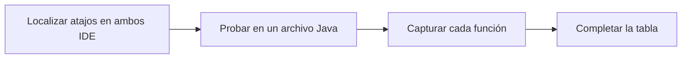

# AR207-Mohamed Amin Ben Assad El Arine
**Mohamed Amin Ben Assad El Arine**  
**Módulo:** Entornos de Desarrollo  
**Curso:** 1.º DAW


Nombre: [Tu nombre]
Sistema operativo: Windows

## Enunciado

Explorar funciones de edición que permiten trabajar con código Java de forma más rápida en IntelliJ IDEA y VS Code. Se localiza el atajo o comando de menú de cada función en ambos IDE, se prueban sobre un archivo Java y se adjuntan capturas (3 puntos).

> Las capturas marcadas como **[CAPTURAR]** debes hacerlas tú y guardarlas en `assets/` con los nombres indicados.



---

## Solución / procedimiento

### Archivo de prueba

Para probar las funciones se puede usar un archivo `Pruebas.java` como este:

```java
public class Pruebas {
    public static void main(String[] args) {
        int a = 5;
        int b = 10;
        int suma = a + b;
        System.out.println("Suma: " + suma);
        System.out.println("Fin del programa");
    }

    public static int multiplicar(int x, int y) {
        return x * y;
    }
}
```

### Tabla comparativa (identificar atajos: 1,5 p)

| Funcionalidad | IntelliJ IDEA | VS Code | Captura |
|---|---|---|---|
| Selección múltiple | `Alt+J` selecciona la siguiente ocurrencia; `Ctrl+Alt+Shift+J` selecciona todas | `Ctrl+D` selecciona la siguiente ocurrencia; `Ctrl+Shift+L` todas; también `Alt+Click` para añadir cursores | **[CAPTURAR]** `assets/seleccion-multiple.png` |
| Selección por columna | `Alt+Shift+Insert` | `Shift+Alt` + arrastrar el ratón, o `Ctrl+Shift+Alt+↑/↓` | **[CAPTURAR]** `assets/seleccion-columna.png` |
| Plegado de código | Iconos de plegado en el gutter; `Ctrl+-` (plegar) y `Ctrl++` (desplegar) | `Ctrl+Shift+[` (plegar), `Ctrl+Shift+]` (desplegar), `Ctrl+K Ctrl+0` (plegar todo), `Ctrl+K Ctrl+J` (desplegar todo) | **[CAPTURAR]** `assets/plegado.png` |
| Formato de código | `Ctrl+Alt+L` (Code > Reformat Code) | `Shift+Alt+F` (documento) y `Ctrl+K Ctrl+F` (selección) | **[CAPTURAR]** `assets/formato.png` |
| Búsqueda y reemplazo global | `Ctrl+Shift+F` (buscar en ruta) y `Ctrl+Shift+R` (reemplazar en ruta) | `Ctrl+Shift+F` (buscar en archivos) y `Ctrl+Shift+H` (reemplazar en archivos) | **[CAPTURAR]** `assets/busqueda-global.png` |
| Comentar / descomentar | `Ctrl+/` (línea) y `Ctrl+Shift+/` (bloque) | `Ctrl+/` (línea) y `Shift+Alt+A` (bloque) | **[CAPTURAR]** `assets/comentar.png` |
| Duplicar línea | `Ctrl+D` | `Shift+Alt+↓` (o `↑`) | **[CAPTURAR]** `assets/duplicar-linea.png` |
| Ir a definición / implementación | `Ctrl+B` (definición) y `Ctrl+Alt+B` (implementación) | `F12` (definición) y `Ctrl+F12` (implementación) | **[CAPTURAR]** `assets/ir-a-definicion.png` |

> Los atajos de plegado de IntelliJ IDEA no aparecen en el temario: compruébalos en tu IDE (**Code > Folding** o **Settings > Keymap**) y corrígelos si en tu teclado son otros. Si alguna función no tiene equivalente directo en un IDE, indícalo en la celda.

### Cómo probar cada función (demostrar las funciones: 1 p)

1. **Selección múltiple:** colocar el cursor sobre `System` y pulsar el atajo varias veces para seleccionar las dos apariciones; escribir para editar ambas a la vez.
2. **Selección por columna:** seleccionar en vertical las líneas de `int a`, `int b` y `int suma` y añadir un texto al inicio de todas.
3. **Plegado:** plegar el método `main` y desplegarlo con el atajo o el icono del gutter.
4. **Formato:** desordenar la sangría del archivo y aplicar el formato; comprobar que se corrige.
5. **Búsqueda y reemplazo global:** buscar `System.out.println` en todo el proyecto y reemplazarlo (por ejemplo por `System.out.printf`).
6. **Comentar / descomentar:** seleccionar varias líneas y comentarlas y descomentarlas.
7. **Duplicar línea:** duplicar la línea `int b = 10;`.
8. **Ir a definición / implementación:** colocar el cursor sobre `multiplicar` (o sobre una llamada a un método) y saltar a su definición.

Resultados observados: `[describe brevemente qué ocurrió en cada IDE y si alguna función no tiene equivalente directo]`

---

## Capturas / evidencias (0,5 p)

Adjunta capturas claras de cada función funcionando, preferiblemente una de IntelliJ IDEA y otra de VS Code, o una captura por función con ambas ventanas si se distinguen bien.

| Función | Archivo |
|---|---|
| Selección múltiple | `seleccion-multiple.png` |
| Selección por columna | `seleccion-columna.png` |
| Plegado de código | `plegado.png` |
| Formato de código | `formato.png` |
| Búsqueda y reemplazo global | `busqueda-global.png` |
| Comentar / descomentar | `comentar.png` |
| Duplicar línea | `duplicar-linea.png` |
| Ir a definición / implementación | `ir-a-definicion.png` |

Para enlazarlas en Markdown con ruta relativa:

```markdown

```

## Entrega

1. Nombrar el archivo como `AR207TuNombre.md`.
2. Crear `AR207TuNombre.zip` con el `.md` y la carpeta `assets/`, sin carpeta envolvente extra.
3. Descomprimirlo en otra ubicación y comprobar que las imágenes se ven.
4. No entregar PDF.

## Reparto de puntos (3 p)

| Apartado | Puntos |
|---|---|
| Identificar atajos o comandos | 1,5 |
| Demostrar las funciones | 1 |
| Capturas claras | 0,5 |
